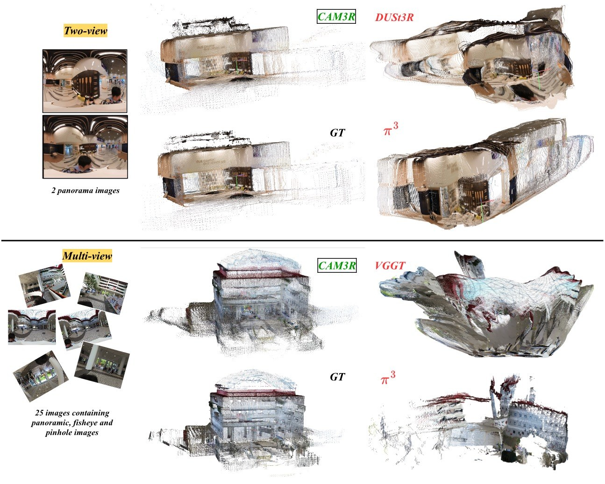

<div align="center">

# CAM3R: Camera-Agnostic Model for 3D Reconstruction

**Namitha Guruprasad<sup>1</sup>, Abhay Yadav<sup>1</sup>, Rama Chellappa<sup>1</sup>, Cheng Peng<sup>2</sup>**

<sup>1</sup> Johns Hopkins University &nbsp;&middot;&nbsp; <sup>2</sup> University of Virginia

**ECCV 2026**

[**🌐 Live demo**](https://nam1410.github.io/cam3r/demo/) &nbsp;·&nbsp; [**arXiv**](https://arxiv.org/abs/2603.22631) &nbsp;·&nbsp; [](LICENSE) [](#-installation) [](requirements.txt)



Two-view and multi-view reconstructions on unseen 360Loc scenes, where pinhole-trained baselines fail.

</div>

## What it does

Two uncalibrated, unposed images go in. Dense 3D geometry and the relative camera pose come out.

- Panorama, fisheye, pinhole, or any mix of the two, with one set of weights.
- No intrinsics, no poses, no dataset class, one feed-forward pass.
- A shared Ray Module predicts per-pixel ray directions; a Cross-view Module predicts radial distance, confidence and relative pose.
- This release is the two-view network. Multi-view Ray-Aware Global Alignment is not included yet.

Orbit the live point clouds on the [demo site](https://nam1410.github.io/cam3r/demo/).

## 🔧 Installation

```bash
git clone https://github.com/nam1410/cam3r.git
cd cam3r

conda create -n cam3r python=3.10 -y
conda activate cam3r          # or: python -m venv .venv && source .venv/bin/activate

pip install -r requirements.txt
```

Python 3.10+, PyTorch 2.0+, CUDA recommended. Both eval scripts accept `--device cpu`.

### Weights

| Weights | Source | Needed for |
|---|---|---|
| UniK3D adapter | Auto-downloaded from HuggingFace when the model is built | Always |
| `DUSt3R_ViTLarge_BaseDecoder_512_dpt.pth` | DUSt3R authors, place in `checkpoints/` | Training |
| `cam3r.pth` | **Not yet released.** The checkpoint is being uploaded and a link will be added here. | Inference, evaluation |

> Until `cam3r.pth` is published, the code can be installed and inspected but not run. The commands below are complete and will work unchanged once the checkpoint is in `checkpoints/`.

Released weights inherit the CC BY-NC-SA 4.0 non-commercial restriction.

## ⚡ Quick start

```bash
python3 eval_two_view_zeroshot.py \
    --input  /path/to/folder_with_two_images \
    --outdir out/ \
    --ckpt   checkpoints/cam3r.pth
```

Writes `overlay_*.ply` (the fused pair), the per-view clouds, and a match-quality panel. Open them in [MeshLab](https://www.meshlab.net/) or [CloudCompare](https://www.cloudcompare.org/).

## 📊 Evaluation

```bash
python3 eval_two_view.py \
    --ckpt checkpoints/cam3r.pth \
    --batch-size 8 \
    --pano2d3ds-root          /path/to/2D3DS/preprocessed_gt_rays \
    --panofishpin2d3ds-root   /path/to/2D3DS/preprocessed_pano_fish_pin_gt_rays \
    --pano360loc-root         /path/to/360Loc/preprocessed_panos_scaled \
    --panofishpin360loc-root  /path/to/360Loc/preprocessed_panoFishPin \
    --fisheyearia-root        /path/to/ADT/preprocessed_gt_rays \
    --fisheyepinholearia-root /path/to/ADT/preprocessed_cross_domain \
    --megadepth-root          /path/to/MegaDepth/preprocessed_gt_rays \
    --co3d-root               /path/to/CO3Dv2/preprocessed_pin_fish_with_rays
```

Pass only the roots you have. `--max-pairs N` for a quick pass, `--two-view-test` for the paper's qualitative dumps.

### Two-view relative pose estimation

Accuracy at 15°, higher is better. Table 1 of the paper. CO3Dv2 is zero-shot, never trained on.

| Model | 2D3DS RRA@15 | 2D3DS RTA@15 | MegaDepth RRA@15 | MegaDepth RTA@15 | CO3Dv2 (zero-shot) RRA@15 | CO3Dv2 (zero-shot) RTA@15 | 360Loc RRA@15 | 360Loc RTA@15 | ADT RRA@15 | ADT RTA@15 |
|---|---|---|---|---|---|---|---|---|---|---|
| DUSt3R | 10.6 | 6.0 | 95.6 | 80.8 | 94.7 | 43.1 | 0.0 | 0.0 | 91.0 | 63.6 |
| MASt3R | 18.3 | 9.3 | 69.7 | 56.4 | **98.4** | 33.4 | 39.8 | 5.3 | 96.6 | 63.5 |
| Pow3R | 7.5 | 6.0 | 96.2 | 74.2 | 95.8 | 38.3 | 0.0 | 0.0 | 96.6 | 79.2 |
| VGGT | 11.8 | 11.0 | 98.0 | 88.2 | 90.9 | 29.4 | 37.8 | 11.1 | 92.7 | 82.9 |
| π³ | 16.8 | 11.4 | **99.8** | 93.3 | 90.7 | 22.7 | 38.5 | 13.0 | 97.5 | 93.8 |
| **CAM3R-homo** | 65.4 | 56.8 | 97.2 | 92.6 | 96.1 | 66.5 | 58.3 | 54.7 | 98.2 | 93.4 |
| **CAM3R** | **97.7** | **94.3** | 96.8 | **94.2** | 97.5 | **88.2** | **96.0** | **91.0** | **99.0** | **95.0** |

## 🏋️ Training

> [!IMPORTANT]
> Edit the dataset roots and `DUST3R_CKPT`, `OUTPUT_ROOT`, `NPROC` at the top of `scripts/train_cam3r.sh` first. They are placeholders.

```bash
bash scripts/train_cam3r.sh        # phase 1 (homogeneous pairs) then phase 2 (heterogeneous)
bash scripts/train_cam3r.sh 1      # CAM3R-homo only
bash scripts/train_cam3r.sh 2      # phase 2, resuming the phase-1 checkpoint
```

### Data format

**Preprocessing scripts are not included in this release.** Pair curation, splits and
hyperparameters are described in the paper. Every dataset root must already hold:

```
<root>/all_metadata.npz            scenes, images, pairs
<root>/<scene>/<subscene>/.jpg
<root>/<scene>/<subscene>/.npz
```

| `all_metadata.npz` | |
|---|---|
| `scenes` | scene names |
| `images` | image names, indexed by `im1_id` / `im2_id` |
| `pairs` | records of `(scene_id, im1_id, im2_id, score)`, `score` being co-visibility |

| per-view `.npz` | |
|---|---|
| `intrinsics` | 3×3 |
| `cam2world` | 4×4 |
| `gt_rays` | `(H, W, 3)` unit ray directions in the camera frame |

Points are `gt_rays * radial_distance`, so the rays are unit-norm and depth is radial,
not along the optical axis.

## 📁 Repository layout

```
cam3r/
├── eval_two_view.py                  evaluation with GT: RRA/RTA/mAA tables
├── eval_two_view_zeroshot.py         two arbitrary images, no dataset class
├── train.py                          training entry point
├── scripts/train_cam3r.sh            two-phase training launcher
├── dust3r/
│   ├── model_with_unik3d_encoder_dust3r_adapter_relpose.py   CAM3R network
│   ├── unik3d_encoder_dust3r_adapter.py                      Ray Module adapter
│   ├── confidence_geometry.py                                3D-3D MNN confidence
│   ├── heads/                        DPT heads: radial distance, confidence
│   ├── datasets/                     the eight dataset classes
│   └── utils/, vitl.json
├── croco/                            CroCo backbone (vendored)
├── UniK3D/                           UniK3D Ray Module (vendored)
├── assets/                           README figures
├── requirements.txt, LICENSE, NOTICE
```

## 📄 License

[CC BY-NC-SA 4.0](LICENSE): non-commercial, with attribution, share-alike. Inherited from [DUSt3R](https://github.com/naver/dust3r), [CroCo](https://github.com/naver/croco) and [UniK3D](https://github.com/lpiccinelli-eth/UniK3D), which are vendored here and which we thank. Per-component attribution is in [NOTICE](NOTICE); please cite them alongside CAM3R.

## 📚 Citation

```bibtex
@inproceedings{guruprasad2026cam3r,
  title   = {CAM3R: Camera-Agnostic Model for 3D Reconstruction},
  author  = {Guruprasad, Namitha and Yadav, Abhay and Chellappa, Rama and Peng, Cheng},
  eprint    = {2603.22631},
  archivePrefix = {arXiv},
  booktitle = {European Conference on Computer Vision (ECCV)},
  year    = {2026}
}
```
